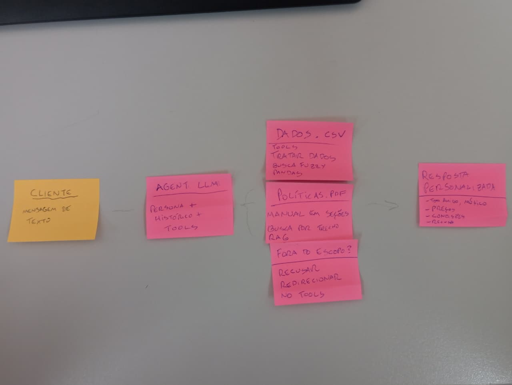

# AI Customer Service Agent for Empório da Música<span class="subtitle">Technical case submission | Artefact — AI Engineer</span><span class="meta">Candidate: Gabriel Pereira Santos · Date: November 4, 2026 · Repository: https://github.com/gabirusky/teste-emporio-agent · Build: Unified product search (single search_products tool)</span>

---

## 1. Project Overview

Empório da Música is a fictional musical instrument store in Campo Grande, Brazil. Its customers regularly ask about instrument availability, prices, stock, brands, order status, delivery, payment methods, and return policies. The goal of this project is to prototype a Python text agent that handles those requests accurately while keeping every business fact grounded in the supplied data — never guessed by the model.

**The language model understands and communicates; application tools retrieve the facts.** Prices, stock, orders, promotions, and policy rules always come from controlled Python tools that read the authoritative CSVs and policy PDF, so answers are auditable and hallucination-free.

### What the agent does

- Answers customers in their language: Brazilian Portuguese for Portuguese, English for English.
- Searches the product catalog with one unified tool: name/query, brand, category, minimum and maximum price, availability, and deterministic sorting by price, stock, or name.
- Reports brand, list price, final price, stock, status, total matching results, and applied filters.
- Looks up demonstration orders by numeric ID, including items, tracking, and delivery estimate.
- Retrieves policy excerpts for hours, address, payments, installments, returns, exchanges, warranty, shipping, promotions, privacy, and store scope.
- Refuses accessory and unrelated requests, redirecting to supported topics.
- Recognizes instrument categories missing from the catalog (e.g., flauta doce / wind instruments) and answers honestly instead of recommending unrelated products.
- Deduplicates repeated tool calls within the same turn.
- Keeps recent conversation context in memory for the current session.
- Runs as a terminal chat or a local browser chat with per-session history.

### Persona and tone

The agent adopts the store persona from the policy manual: friendly, welcoming, informal yet professional — like a friend who understands music. The customer-facing language follows the customer's latest message: Portuguese for Portuguese, English for English. It never invents prices, stock, deadlines, promotions, or policy rules, and it never places orders, reserves stock, or processes payments.

---

## 2. Solution Architecture

Hybrid architecture: LLM function calling plus deterministic CSV lookups and lexical/fuzzy retrieval over the policy PDF. Terminal CLI and local browser chat.

```text
Customer message (CLI or web)
        |
        v
MusicStoreAgent + history
        |
        v
LLM with function-calling schemas
        |
        +--> search_products --------> products + promotions + categories
        +--> get_product_details ------> products + promotions
        +--> get_order_status -------> orders + order items
        +--> search_policies --------> policy PDF (section-aware RAG)
        +--> redirect_out_of_scope --> store scope rules
        |
        v
Grounded answer in the customer's language
```

| Module | Responsibility |
|---|---|
| `agent.py` | System prompt, tool loop, language policy, history, safety |
| `tools.py` | Tool wrappers and function schemas |
| `data_store.py` | CSV loading, validation, search, sorting, promotions, orders |
| `policy_retriever.py` | PDF extraction, section-aware chunks, bilingual expansion |
| `cli.py` / `web.py` | Terminal and browser chat |
| `config.py` | Environment-backed settings |

---

## 3. Core Refactor: One Unified Product Query

**Before:** product search and ranking were inconsistent — brand, price-range, and ranking filters lived in separate code paths and were error-prone.

**After:** every product question goes through a single tool, `search_products`. Filtering and sorting are deterministic inside `data_store.py`, never in the LLM.

**Parameters:** `query`, `brand`, `category`, `min_price`, `max_price`, `only_available` (default `true`), `sort_by` (`price|stock|name`), `sort_order` (`asc|desc`), `limit`.

**Filter order (deterministic):** Brand → Availability → Category/name → Price range → Sorting → Limit.

**Brand matching:** case-insensitive and normalized (`Yamaha` = `YAMAHA` = `yamaha`). products.csv has no brand column, so a brand field is derived in memory against an explicit brand lexicon; product-type words like "Bateria" or "Teclado" are never mistaken for brands.

**Sorting uses actual numeric prices**, not formatted currency strings.

**No fallback:** an empty brand or price search stays empty. It never silently removes a filter or returns another brand's products.

**Result shape:** product id, name, brand, price, stock, status, total matching results, applied filters — auditable end to end.

---

## 4. Tool Design & System Prompt

Only one catalog tool exists: `search_products`. `sort_by`/`sort_order` inside `search_products` handles cheapest, most expensive, alphabetical, and stock rankings. No per-operation tool added — the architecture stays simple.

`SYSTEM_PROMPT` tells the model to use `search_products` for every product question, combine filters in one call, never sort itself, and report zero matches honestly instead of broadening or falling back to another brand.

---

## 5. Testing and Evaluation

```bash
python -m pytest -q   # Result: 43 passed (previously 32)
```

New regressions cover every required edge case:

| Test | Verifies |
|---|---|
| Most expensive instrument in stock | numeric descending sort, `limit=1` |
| Cheapest instrument in stock | numeric ascending sort |
| Cheapest Yamaha instrument | brand + sort, single brand only |
| All available products from a brand | brand + availability + full set |
| Brand search uppercase/lowercase | identical results |
| Brand with no matches | empty, no fallback |
| Yamaha never returns other brands | cross-brand isolation |
| Price sorting uses numeric values | ascending/descending |
| Brand + price range + availability | combined filters |
| No global-catalog fallback on zero matches | empty brand stays empty |
| Unified schema, one search tool only | one search tool |

Dataset counts match the actual CSV: 65 products, 61 available, 402 units in stock. CSV never altered; no invented products.

---

## 6. Human Impact (Edge Cases)

| Customer question | Tool call | Result |
|---|---|---|
| "qual o instrumento mais caro da loja?" | `search_products(sort_by=price, sort_order=desc, limit=1)` | Nord Synth 2 Pro — R$ 19.567,00, 3 units |
| "qual modelo YAMAHA é o mais barato?" | `search_products(brand=Yamaha, sort_by=price, sort_order=asc, limit=1)` | Yamaha C40 Nylon Natural — R$ 599,90 |
| "qual seu estoque completo? número total?" | `search_products(limit=500)` | 61 models, 402 units available |
| "me dê um script python para comprar violão" | `redirect_out_of_scope` | Refused; redirected to catalog/help |

---

## 7. Limitations & Setup

**Limitations:** static CSV snapshot (not a live ERP); no order authentication; lexical (not embedding-based) RAG; only `is_active` promotions authoritative; in-memory history; no side effects (cannot place orders or process payments).

**Setup:**

```bash
git clone https://github.com/gabirusky/teste-emporio-agent.git
cd teste-emporio-agent
python3 -m venv .venv
source .venv/bin/activate
python -m pip install --upgrade pip
python -m pip install -e ".[dev]"
cp .env.example .env
# Set LLM_BASE_URL, LLM_API_KEY, LLM_MODEL in .env
python -m pytest -q        # 43 passed
emporio-agent              # terminal chat
emporio-web --port 8000    # browser chat
```

Verified configuration (NVIDIA NIM): `nvidia/nemotron-3.5-lightning-30b-a3b`. OpenRouter also supported. `.env` is local and never committed.

---

## Appendix A — Planning Sketch

Hand-drawn sketch used to plan the agent flow before implementation: customer message → LLM agent with persona and tools → CSV lookups and policy retrieval → out-of-scope branch → personalized response. Notes in Portuguese because the store and its manual are in Portuguese.

<figure class="appendix">
  
  <figcaption>Planning sketch: tool flow, data sources, response behavior before implementation.</figcaption>
</figure>
